<p align="center">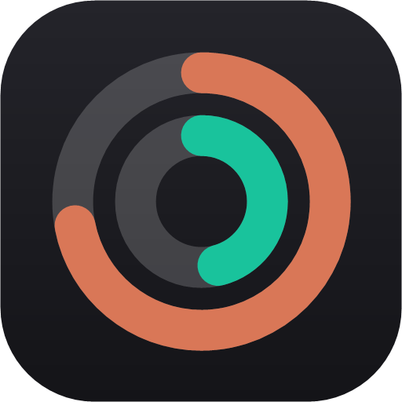</p>

<h1 align="center">Ringside</h1>

<p align="center">Your Claude Code and Codex limits, always in view. Windows, macOS and Linux. 100% free and open source.</p>

<p align="center"><a href="https://github.com/KNIGHT-AI-AV/ringside/releases/latest"></a> <a href="https://github.com/KNIGHT-AI-AV/ringside/releases"></a> <a href="LICENSE"></a>  <a href="https://github.com/KNIGHT-AI-AV/ringside/stargazers"></a></p>

<p align="center"><a href="https://github.com/KNIGHT-AI-AV/ringside/releases/latest/download/Ringside-win-Setup.exe"><b>Windows</b></a> &nbsp;·&nbsp; <a href="https://github.com/KNIGHT-AI-AV/ringside/releases/latest/download/Ringside.AppImage"><b>Linux</b></a> &nbsp;·&nbsp; <a href="https://github.com/KNIGHT-AI-AV/ringside/releases/latest/download/Ringside-osx-arm64.zip"><b>macOS</b></a> &nbsp;·&nbsp; <a href="https://github.com/KNIGHT-AI-AV/ringside/releases/latest">All downloads</a></p>

<p align="center">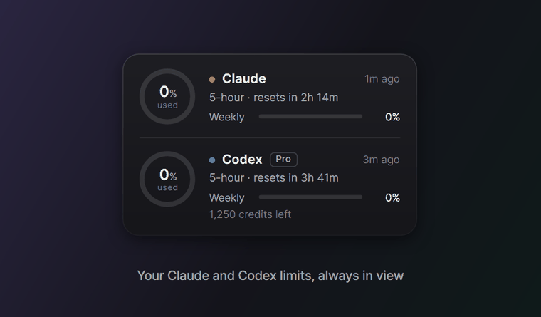</p>

Ringside is a small always-on-top meter for your Claude and Codex usage limits. It shows how much of each limit you have used, or how much is left, and when it resets, so a limit never catches you in the middle of a task.

It never reads your login. Many usage meters read the token Claude Code or Codex keeps on disk and call the provider's servers with it. Ringside only reads the usage numbers your apps already save on your computer, and it never sends your usage anywhere.

## Three views

<p align="center">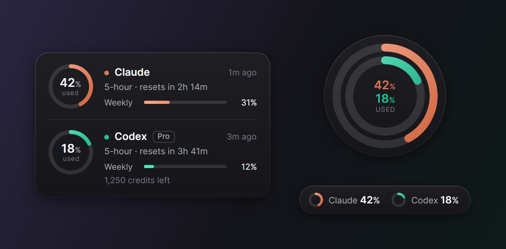</p>

- Card shows everything: each limit, when it resets, your plan and credits.
- Orb is the Ringside logo come to life: Claude's ring outside, Codex's ring inside.
- Pill is one slim line for a corner of the screen.

Double-click the meter to switch. Right-click it for the quick panel.

## Fill up, or tank

<p align="center">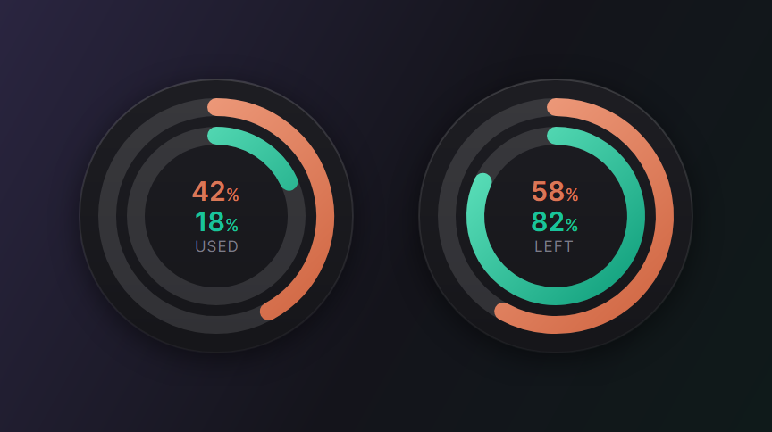</p>

Watch usage climb toward the limit, or watch what's left drain like a fuel gauge. Every number, tooltip, notification and the Claude Code status line speak the same way.

## Your colors

<p align="center">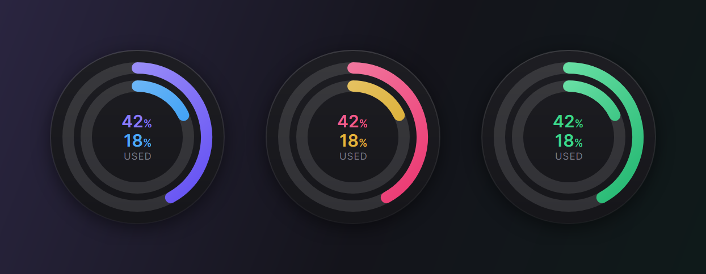</p>

Pick any color for each app, or switch to traffic light: green while there's room, amber near the limit, red at it.

## Split them apart, snap them together

<p align="center">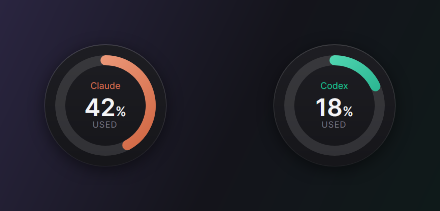</p>

Use only one of the two? Turn the other meter off. Use both? Keep them in one meter, or split them into two you can put anywhere. Drop one onto the other and they join again.

## Smart forecast and alerts

<p align="center">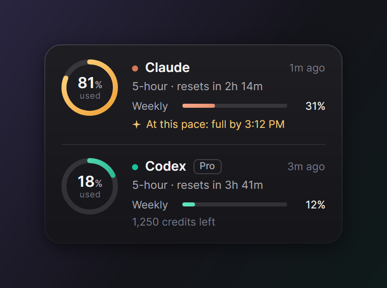 &nbsp; 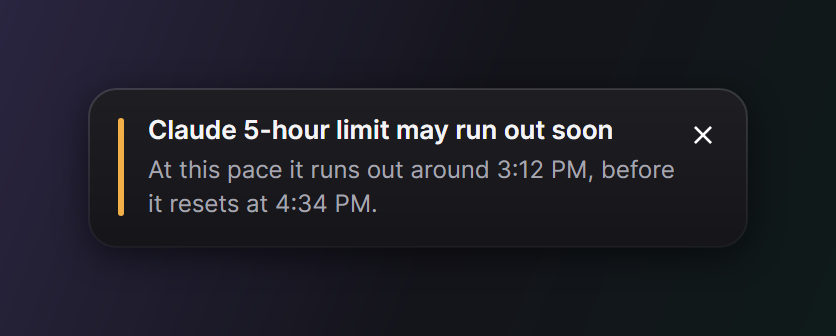</p>

When a limit is climbing fast, Ringside works out when it will run out at your current pace and tells you if that's before the reset. It also turns a gauge amber, then red, as it gets close (75% and 90% by default, or your own thresholds) and can notify you at each step and when a limit resets.

## Install

| | Download | Then |
|---|---|---|
| Windows 10 and 11 | [Ringside-win-Setup.exe](https://github.com/KNIGHT-AI-AV/ringside/releases/latest/download/Ringside-win-Setup.exe) | Run it. It installs for your user only, with no admin prompt. |
| macOS 12 or later, Apple silicon | [Ringside-osx-arm64.zip](https://github.com/KNIGHT-AI-AV/ringside/releases/latest/download/Ringside-osx-arm64.zip) | Unzip it, move Ringside to Applications and open it. It is signed and notarized by Apple and lives in the menu bar. |
| Linux, x64 | [Ringside.AppImage](https://github.com/KNIGHT-AI-AV/ringside/releases/latest/download/Ringside.AppImage) | Make it executable (`chmod +x Ringside.AppImage`) and run it. |

The welcome cards walk you through the rest: what Ringside found on your computer, your view, used or left, colors, alerts and and the Claude Code link for live Claude limits.

<p align="center">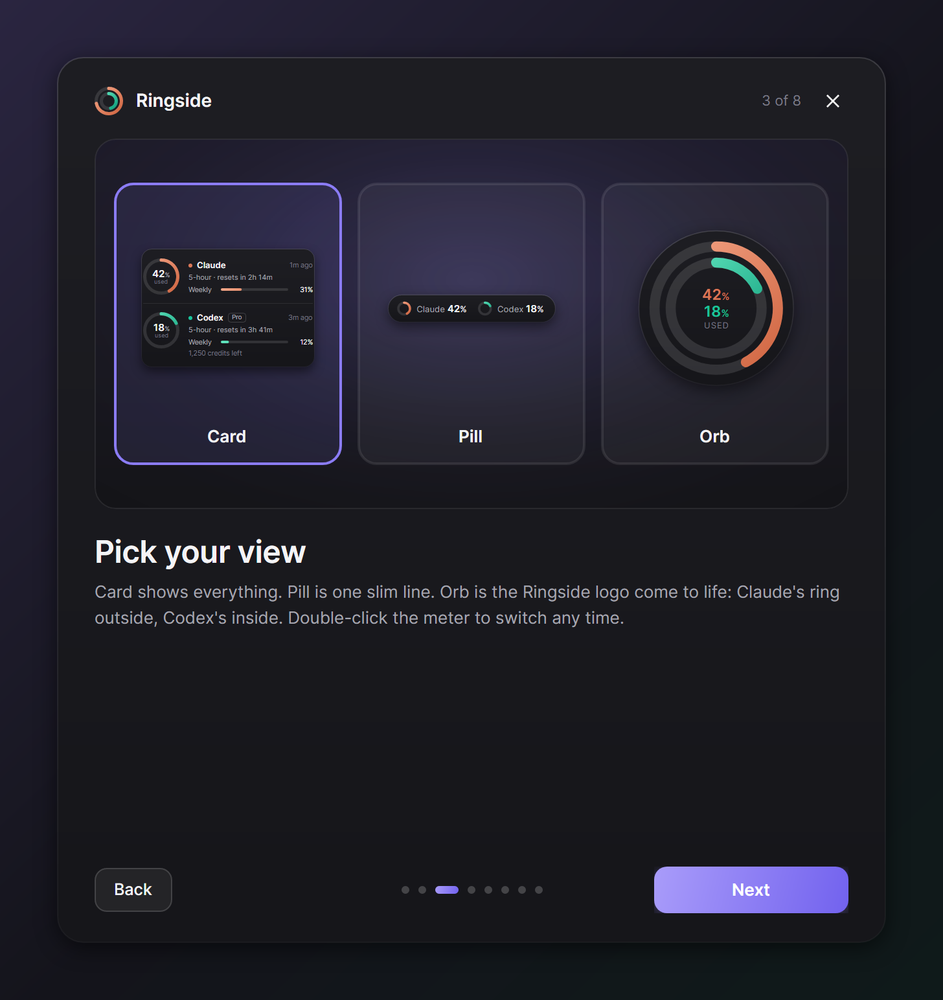 &nbsp; 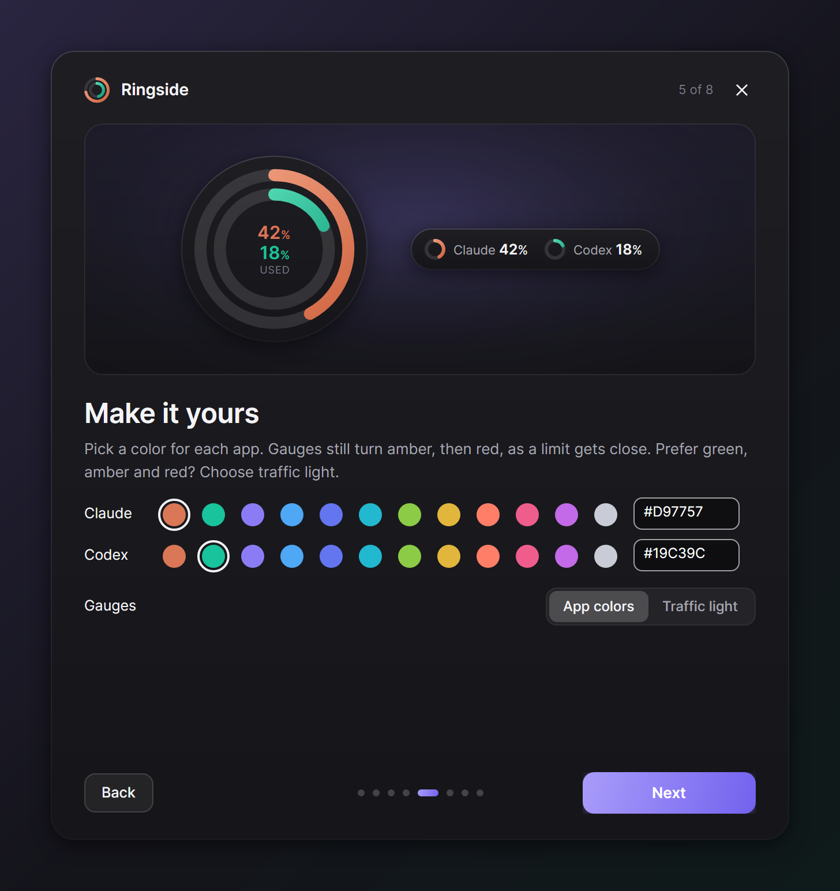</p>

Windows may say "Windows protected your PC" because the installer is new. Choose More info, then Run anyway. Every download's SHA-256 checksum is listed in SHA256SUMS.txt on the release page.

On Linux, the tray icon needs a desktop with tray support (on GNOME, the AppIndicator extension).

## What it shows

| Limit | Where the number comes from | How fresh |
|---|---|---|
| Claude 5-hour and weekly | The Claude desktop app's own usage log | When the app refreshes its usage card, sometimes hours apart |
| Claude 5-hour and weekly, live | Claude Code, through Ringside's plugin and status line link (see below) | After every Claude Code reply |
| Codex 5-hour and weekly, plan and credits | Codex's local session logs | After every Codex reply |

The big gauge shows the limit closest to running out, or the 5-hour or weekly limit if you pin one. Hover any gauge to see every limit, when it resets and where the number came from.

## Using it

- Drag it anywhere. It snaps to screen edges and remembers its spot.
- Double-click to switch between Card, Pill and Orb.
- Right-click it for the quick panel: views, used or left, split or join, keep on top, click-through and settings.
- The tray or menu bar icon is a tiny copy of the rings, so you can hide the meter and still keep an eye on your limits.
- It steps aside for full-screen video, games and presentations.
- It never takes focus away from what you are typing in.

<p align="center">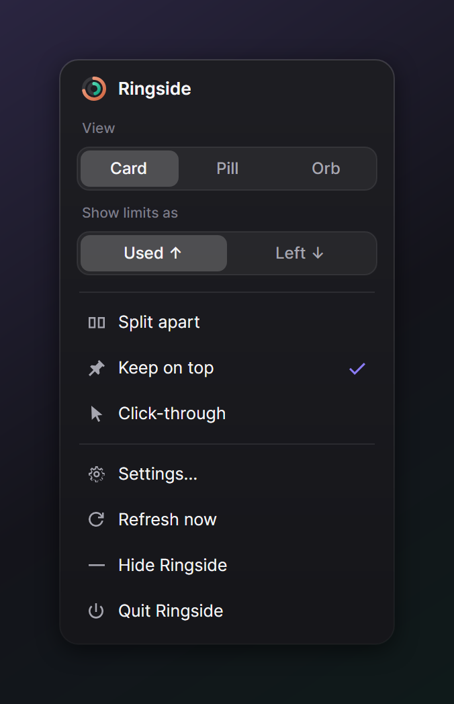</p>

## Settings

<p align="center">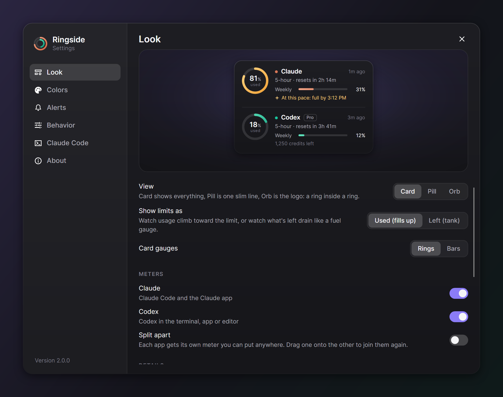</p>

Settings has a live preview that redraws as you change things: the view, used or left, rings or bars on the card, which meters to show, split or joined, which limit the big gauge follows, countdown or clock reset times, size, opacity, each app's color, color style, alert thresholds, notifications, keep on top, click-through, start at login and updates.

## Live Claude limits (recommended)

The Claude desktop app writes its usage log only now and then, so on its own, Ringside's Claude numbers can be hours old. Claude Code knows your exact limits after every reply, and Ringside can get them from it.

<p align="center">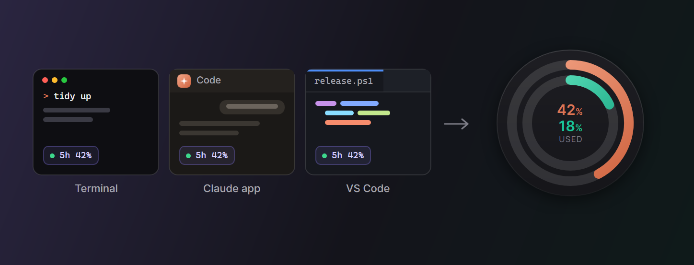</p>

Turn on Live Claude limits in the welcome cards or in Settings, Claude Code. Ringside then adds two small things to Claude Code:

- A Claude Code plugin that hands Ringside your 5-hour and weekly limits after each turn, in the terminal, the Claude app's Code tab and VS Code. It reads no credentials, makes no network calls and writes one small file that Ringside reads. Its source is in the claude-plugin folder of this repo, and `/plugin` in Claude Code lists it.
- A status line link for Claude Code in a terminal. If you already had a status line, it keeps running and showing exactly what it showed before. If you had none, you get a short summary: `5h 26% · resets 2h 29m | 7d 12%`

The first time Ringside changes your Claude Code settings.json, it saves a copy next to it as settings.json.ringside-backup. Turning the option off, or uninstalling Ringside, takes both out again and puts your old status line back.

## Privacy

- Ringside reads three things: the Claude desktop app's usage log (plan-usage-history.json), the limits Claude Code hands to Ringside's plugin and status line link if you connect them, and Codex's session logs. It keeps only the usage numbers.
- It never opens your Claude or Codex login files and never contacts Anthropic or OpenAI.
- It only talks to GitHub, to check for and download updates, about every 6 hours. GitHub sees your IP address and may see Ringside's version and your system type, such as Windows x64. Ringside sends no usage numbers, no account details and no ID. You can turn update checks off in Settings.
- Its settings live in %APPDATA%\Ringside on Windows, ~/Library/Application Support/Ringside on macOS and ~/.config/Ringside on Linux.

## Uninstall

- Windows: open Settings, then Apps, find Ringside, Uninstall. That removes the startup entry and restores your Claude Code status line.
- macOS and Linux: in Ringside's Settings, About, choose Remove Ringside's changes and quit. Then drag Ringside from Applications to the Trash, or delete the AppImage.

To also remove your settings, delete the settings folder listed under Privacy.

## FAQ

Does it work without the Claude desktop app? Yes, if you connect Claude Code. Without either, the Claude meter waits for data.

I only use Codex (or only Claude). Turn the other meter off in the welcome cards or in Settings. Ringside starts with just the one it finds.

Why does the Claude gauge say "as of yesterday 9:09 PM"? The Claude app writes its usage log only when it refreshes its own usage card, which can be hours apart, and the Claude app's Code tab doesn't run status lines. When the newest reading is more than 35 minutes old, the gauge dims and shows when it was taken. For live Claude numbers, turn on Live Claude limits.

Does it count API usage? No. It shows plan limits (such as Pro, Max and Team), which is what the 5-hour and weekly windows are.

## Build from source

You need the .NET 10 SDK. The Windows status line bridge is compiled to native code, which also needs Visual Studio's Desktop development with C++ workload.

```powershell
git clone https://github.com/KNIGHT-AI-AV/ringside
cd ringside
./build.ps1                                   # test, then build Windows, Linux and macOS
./build.ps1 -Version 2.0.0 -Target win -Pack  # one platform plus its installer (needs: dotnet tool install -g vpk)
```

Ringside is [Avalonia](https://avaloniaui.net) on .NET 10, one codebase for all three systems. [Velopack](https://velopack.io) builds the installers and handles updates. The README images and the GIF are rendered from the real UI by `tools/Ringside.Render`.

## Like it?

If Ringside saves you from hitting a limit in the middle of a task, a star on GitHub helps other people find it.

## License

MIT. Ringside is an independent project and is not affiliated with Anthropic or OpenAI. Claude and Codex are trademarks of their owners.
