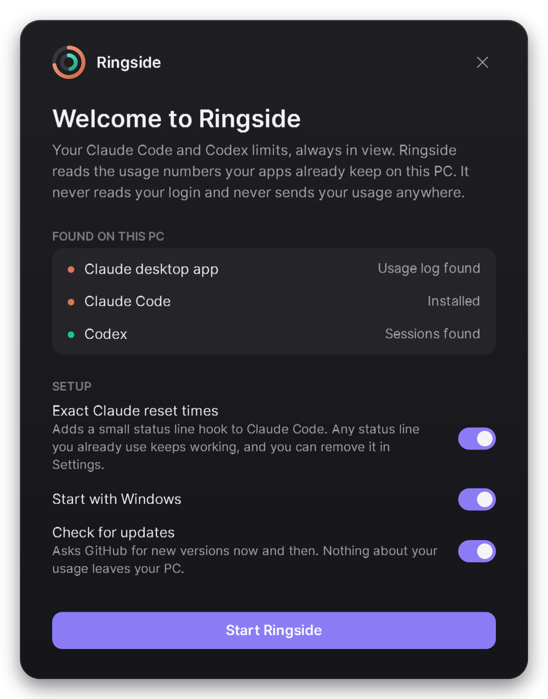
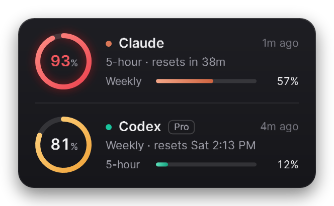
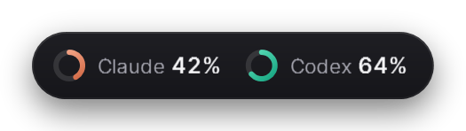
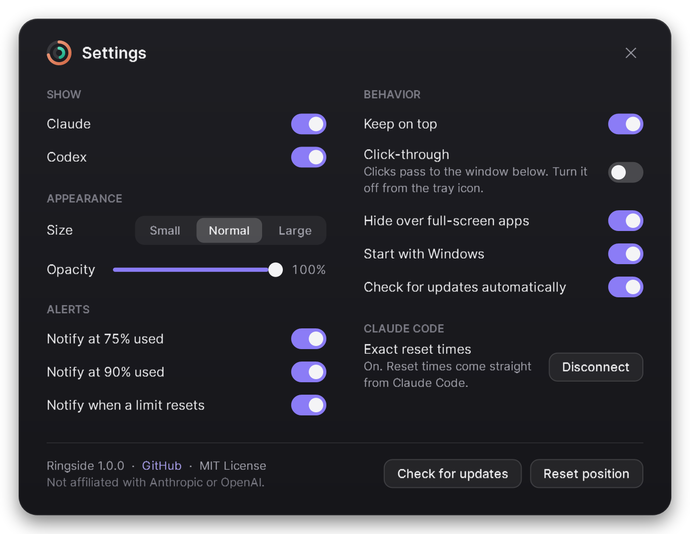

<p align="center"></p>

<h1 align="center">Ringside</h1>

<p align="center">Your Claude Code and Codex limits, always in view on Windows. 100% free and open source.</p>

<p align="center"><a href="https://github.com/KNIGHT-AI-AV/ringside/releases/latest"></a> <a href="https://github.com/KNIGHT-AI-AV/ringside/releases"></a> <a href="LICENSE"></a>  <a href="https://github.com/KNIGHT-AI-AV/ringside/stargazers"></a></p>

<p align="center"><a href="https://github.com/KNIGHT-AI-AV/ringside/releases/latest/download/Ringside-win-Setup.exe">Download for Windows</a> &nbsp;·&nbsp; <a href="https://github.com/KNIGHT-AI-AV/ringside/releases/latest">All downloads</a></p>

<p align="center"></p>

Ringside is a small always-on-top meter for Windows. It shows how much of your Claude and Codex usage limits you have used and when each one resets, so a limit never catches you in the middle of a task.

It never reads your login. Many usage meters read the token Claude Code or Codex keeps on disk and call the provider's servers with it. Ringside only reads the usage numbers your apps already save on your PC, and it never sends your usage anywhere.

## Install

1. Download [Ringside-win-Setup.exe](https://github.com/KNIGHT-AI-AV/ringside/releases/latest/download/Ringside-win-Setup.exe).
2. Run it. It installs for your user only, with no admin prompt, and starts right away.
3. The welcome card shows what it found on your PC. Choose Start Ringside.

<p align="center"></p>

Windows may say "Windows protected your PC" because the installer is new and not code-signed yet. Choose More info, then Run anyway. Every download's SHA-256 checksum is listed in SHA256SUMS.txt on the release page.

Prefer no installer? Download Ringside-win-Portable.zip from the release page, unzip it anywhere and run Ringside.exe.

Works on Windows 10 and 11, 64-bit. Nothing else to install.

## What it shows

| Limit | Where the number comes from | How fresh |
|---|---|---|
| Claude 5-hour and weekly | The Claude desktop app's own usage log | Every 15 minutes while the app is open |
| Claude exact reset times | Claude Code's status line (optional, see below) | After every Claude Code reply |
| Codex 5-hour and weekly, plan and credits | Codex's local session logs | After every Codex reply |

Each ring shows the limit closest to running out. It turns amber at 75% and red at 90%. Hover a ring to see every limit, when it resets and where the number came from.

<p align="center"></p>

## Using it

- Drag it anywhere. It snaps to screen edges and remembers its spot.
- Double-click for the compact pill.
- Right-click it, or the tray icon, for the menu and Settings.
- The tray icon is a tiny copy of the two rings, so you can hide the card and still keep an eye on your limits.
- It steps aside for full-screen video, games and presentations.
- It never takes focus away from what you are typing in.

<p align="center"></p>

## Settings

<p align="center"></p>

Show or hide either meter, change the size and opacity, get a notification at 75% or 90% and when a limit resets, keep it on top, make it click-through, start it with Windows and check for updates.

## Exact Claude reset times (optional)

The Claude desktop app records how much of your 5-hour limit you have used, but not when it resets, so Ringside estimates the reset from its samples. If you use Claude Code in a terminal, Ringside can get the exact time and your weekly limit instead.

Claude Code hands its status line command your current limits after each reply. With this option on, Ringside points that command at ringside-statusline.exe, a small program that saves the limits for Ringside and then prints your status line as before.

- If you already had a status line, it keeps running and showing exactly what it showed before.
- If you had none, you get a short summary: `5h 26% · resets 2h 29m | 7d 12%`
- The first time Ringside changes your Claude Code settings.json, it saves a copy next to it as settings.json.ringside-backup.
- Turning the option off, or uninstalling Ringside, puts your old status line back.

## Privacy

- Ringside reads three things: the Claude desktop app's usage log (plan-usage-history.json), the limits Claude Code passes to its status line if you connect it, and Codex's session logs. It keeps only the usage numbers.
- It never opens your Claude or Codex login files and never contacts Anthropic or OpenAI.
- Its only network request is the update check, which asks GitHub for the latest release. You can turn it off.
- Its settings and data live in %APPDATA%\Ringside.

## Uninstall

Open Settings, then Apps, find Ringside and choose Uninstall. That removes the startup entry and restores your Claude Code status line. To also remove your settings, delete %APPDATA%\Ringside.

## FAQ

Does it work without the Claude desktop app? Yes, if you connect Claude Code. Without either, the Claude meter waits for data.

Why does the Claude ring say "as of 3:12 PM"? The Claude app only writes its usage log while it is open. When the newest reading is more than 35 minutes old, the ring dims and shows when it was taken.

Does it count API usage? No. It shows plan limits (such as Pro, Max and Team), which is what the 5-hour and weekly windows are.

Mac or Linux? Not yet. On a Mac, CodexBar does this job well.

## Build from source

You need the .NET 8 SDK. The status line bridge is compiled to native code, which also needs Visual Studio's Desktop development with C++ workload.

```powershell
git clone https://github.com/KNIGHT-AI-AV/ringside
cd ringside
./build.ps1                       # test and build
./build.ps1 -Version 1.0.0 -Pack  # also build the installer into artifacts/releases (needs: dotnet tool install -g vpk)
```

Ringside is WPF on .NET 8. [Velopack](https://velopack.io) builds the installer and handles updates.

## Like it?

If Ringside saves you from hitting a limit in the middle of a task, a star on GitHub helps other people find it.

## License

MIT. Ringside is an independent project and is not affiliated with Anthropic or OpenAI. Claude and Codex are trademarks of their owners.
